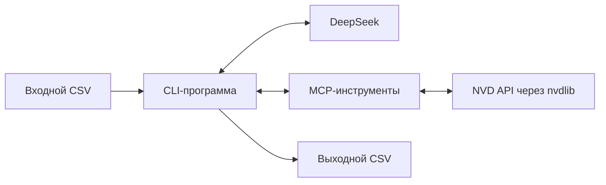

# План автоматизации сопоставления ПО с продуктами CPE

Документ предназначен для последующей реализации ИИ-агентом. Согласованные требования приведены ниже; предложения и оставшиеся вопросы отмечены отдельно. На данном этапе разрабатывается план, а не приложение.

## 1. Цель и границы задачи

По сырым сведениям об установленном ПО определить существующую в словаре NVD тройку `part/vendor/product` либо вернуть объяснимый результат без сопоставления.

- `part` — тип продукта CPE: `a`, `o` или `h`.
- `vendor` и `product` — значения компонентов CPE из словаря NVD.
- `input_version` используется только как дополнительный контекст для идентификации продукта.
- Наличие конкретной входной версии в словаре не требуется. Отсутствие этой версии не опровергает существование продукта.
- Формирование полной CPE установленной версии и определение применимых к машине уязвимостей не входят в текущую задачу.
- Поиск CVE разрешён как вспомогательный способ обнаружить кандидатов на сопоставление.
- Состав ПО заранее неизвестен. Решение должно обрабатывать разные категории: приложения, компоненты, Linux-пакеты, ОС, драйверы, прошивки и другие представленные в отчёте продукты. Не ограничивать поиск списком производителей, платформ или продуктов из примера.
- Если отдельное соответствие для вспомогательного продукта найти не удалось, допускается сопоставление с его основным продуктом по правилам раздела 5. Этот результат должен отличаться от прямого соответствия.
- Принимать только тройки, подтверждённые хотя бы одной действующей записью CPE. Если найдены только `deprecated`-записи и подходящей действующей замены нет, оставить строку несопоставленной с пояснением.
- Пользователь вручную переносит выбранные результаты в свою таблицу правил. Генерация регулярных выражений, воспроизведение существующего бэкенда и автоматическое изменение `mappings.csv` не входят в задачу.

Успешный результат требует двух условий: LLM обосновывает прямое соответствие исходному ПО либо связь с основным продуктом, а программа подтверждает существование выбранной тройки в словаре NVD. Одной проверки существования недостаточно для доказательства правильности интерпретации. Универсальность поиска не означает, что для каждого ПО обязательно существует подходящая запись в словаре.

## 2. Входные данные

CSV с разделителем `,` и обязательными столбцами:

| Столбец | Содержание | Пример |
|---|---|---|
| `input_vendor` | Производитель из отчёта инвентаризации | `Корпорация Майкрософт` |
| `input_product` | Название установленного ПО | `Microsoft Office, для дома и бизнеса 2010` |
| `input_version` | Строка версии из отчёта | `14.0.6029.1000` |

- Наличие столбца не гарантирует непустое значение. Пустые `input_vendor` и `input_version` сами по себе не препятствуют поиску.
- Использовать CSV-парсер с поддержкой кавычек, запятых внутри значений и строковых версий.
- Исходные значения сохранять без изменения; нормализацию выполнять над рабочей копией.
- Реальные входные примеры находятся в `reports/`; небольшой пример также есть в `examples/report.csv`.
- Из любого отчёта извлекать только три входных столбца. Дополнительные поля различаются между файлами: встречаются `cpe_*`, `guessed_cpe`, `matched_cpe`, оценки уверенности и сведения о прежних правилах. Не передавать их модели и не использовать как готовые правильные ответы.
- Существующие результаты сопоставления в отчётах не являются эталонной разметкой.
- Сохранить порядок и количество входных записей в выходном файле. Одинаковые входные тройки можно обрабатывать один раз с восстановлением всех повторов в результате.
- Гарантирован только контекст трёх входных полей. Не требовать дополнительных сведений о платформе или дистрибутиве для запуска.

Обычный объём отчёта — 2500–3000 строк; встречались отчёты примерно до 7000 строк. Это ориентир для проверки масштаба, а не ограничение входного файла. Допускается длительный запуск без участия пользователя, например на ночь. Жёсткого срока завершения и бюджета стоимости API нет; приоритет — качество сопоставления, соблюдение ограничений сервисов и возможность продолжить обработку после прерывания. Завершение любого отчёта за одну ночь не гарантируется.

### Роль ручной таблицы `mappings.csv`

Это вспомогательный материал для ручной проверки результатов и последующего пополнения правил пользователем. Таблица составлена вручную, во многом корректна, но содержит ошибки и не должна считаться безусловным эталоном.

- Формат отличается от входных отчётов: разделитель `;`, поля `sw_vendor` и `sw_product` содержат регулярные выражения, целевые значения находятся в `cpe_vendor`, `cpe_product` и `part`.
- В таблице также есть `sw_version`, `cpe_version`, `action` и `regex`; перенос существующей логики обработки версий не входит в проект.
- В текущем бэкенде используется первое подходящее правило в порядке таблицы. Воспроизводить этот алгоритм в новом инструменте не требуется.
- Не использовать таблицу как обязательный источник ответов для LLM, автоматическую замену поиска NVD или зависимость, без которой CLI не может работать.
- Не создавать механизм применения, генерации, редактирования или приоритизации регулярных выражений. Пользователь сам переносит подходящие результаты в таблицу.
- При ручном сравнении расхождение с правилом требует разбора, а не автоматического признания ошибки LLM. Отсутствие подходящего правила не означает отсутствие продукта в NVD.

На момент подготовки плана в `reports/` находится 8 файлов с 10 977 записями, самый большой — `DL-2919.csv` с 6832 записями. В `mappings.csv` — 2105 правил; поле `part` заполнено, у одного правила для `libtheora` пустой `cpe_product`. Это наблюдения о текущих данных, а не ограничения формата; исходные файлы не исправлять автоматически.

## 3. Способ запуска и конфигурация

Самостоятельная CLI-программа читает CSV, организует взаимодействие с облачной LLM DeepSeek и MCP-сервером, проверяет результаты и записывает выходной CSV.

Использовать существующие имена переменных окружения из `.env`:

| Переменная | Назначение |
|---|---|
| `LLM_API_KEY` | Ключ доступа к DeepSeek |
| `LLM_BASE_URL` | Адрес API LLM |
| `DEFAULT_MODEL` | Модель для обработки |
| `NIST_API_KEY` | Ключ API NVD |

Значения модели, адреса и ключей не зашивать в код. Не изменять существующий `.env` и не выводить ключи в журнал. При отсутствии обязательной конфигурации завершать запуск с понятной ошибкой.

LLM выбирает инструмент и его аргументы. CLI выполняет запрос через MCP-клиент и возвращает результат модели. MCP-сервер предоставляет инструменты поиска и проверки через `nvdlib`; он не принимает семантическое решение вместо LLM. Такой цикл соответствует [механизму tool calls DeepSeek](https://api-docs.deepseek.com/guides/tool_calls/).

### Сквозной сценарий работы



1. **Подготовить запуск.** Прочитать настройки, проверить обязательные столбцы CSV и загрузить совместимое сохранённое состояние, если обработка продолжается. Подключить MCP-клиент к серверу; при предложенном локальном варианте CLI запускает сервер один раз на весь запуск.
2. **Взять следующую необработанную запись.** Сохранить исходные значения и позицию строки. Для уже обработанной идентичной входной тройки использовать готовый результат, сохраняя повторы в выходном файле. Для новой тройки создать отдельный контекст поиска, не перенося историю рассуждений о другом продукте.
3. **Передать задачу DeepSeek.** Модель получает три входных поля, инструкции сопоставления, схему итогового ответа и описание доступных MCP-инструментов в формате tool calls. Весь отчёт, прежние сопоставления и ручную таблицу правил в контекст записи не включать.
4. **Выполнять поисковый цикл.** DeepSeek предлагает вызов инструмента с аргументами. CLI проверяет аргументы и защитные пределы, выполняет вызов через MCP и возвращает компактный структурированный ответ модели. Модель выбирает следующий шаг: уточнить запрос, сменить гипотезу, обратиться к CPE или CVE либо предложить окончательный результат. История вызовов, результатов и отклонённых гипотез сохраняется внутри контекста этой записи. Фиксировать обязательный порядок поисковых запросов не нужно.
5. **Проверить предложенный результат.** Проверить схему ответа. Для `matched` и `matched_parent` обеспечить обязательную проверку точной тройки по разделу 6; допустимо повторно использовать действующее подтверждение из кэша текущего запуска. Если проверка отвергла кандидата, вернуть причину модели и продолжить поисковый цикл в пределах защитных ограничений. Для `vendor_only` также требуется подтверждение производителя действующей записью CPE. Наличие только deprecated-записей, неоднозначность, техническую ошибку и незавершённый поиск обрабатывать по соответствующим правилам, не превращая их в успешное сопоставление.
6. **Зафиксировать исход обработки строки.** После принятого результата либо завершения поиска без соответствия записать исходные поля, CPE-компоненты, статус и пояснение. Сохранить прогресс, чтобы завершённую строку не пришлось обрабатывать повторно после прерывания. Если возник общий сбой сервиса, действовать по разделу 8: сохранить уже полученное и не отправлять новые запросы для всех оставшихся строк.
7. **Продолжить обработку файла.** Повторять шаги для оставшихся записей и завершить формирование CSV в исходном порядке. Кэш запросов, подтверждений и результатов идентичных входных троек можно использовать между строками. Ограничители API действуют на весь запуск, а не создаются заново для каждой строки.

Выбор действий принадлежит LLM; выполнение вызовов, соблюдение лимитов, обязательная проверка и сохранение результатов обеспечиваются программой. Цикл должен завершаться принятым результатом, объяснимым отказом, достижением защитного предела либо обработанным сбоем, без бесконечного повторения одинаковых действий.

### Пример обработки одной записи

Условный вход:

```text
input_vendor: Корпорация Майкрософт
input_product: Microsoft .NET Framework 4.5.1 (RUS)
input_version: 4.5.50938
```

LLM может предположить производителя `microsoft`, выполнить поиск .NET Framework, изучить кандидатов и предложить тройку `a/microsoft/.net_framework`. Это поисковая гипотеза, а не заранее заданный правильный ответ. CLI принимает её только после подтверждения действующей записи NVD и при достаточном семантическом обосновании. Отсутствие входной версии `4.5.50938` само по себе не мешает сопоставлению продукта. Если проверка не прошла, её результат возвращается модели для продолжения поиска или объяснимого отказа. Пример иллюстрирует процесс, а не результаты уже выполненного обращения к NVD.

## 4. Разделение ответственности

### Детерминированная часть

- Чтение и запись CSV, проверка входной схемы.
- Безопасная нормализация пробелов и Unicode, дедупликация, кэширование запросов.
- Выполнение MCP-вызовов, контроль аргументов, лимитов и повторных попыток.
- Корректный разбор и формирование CPE с учётом экранирования компонентов.
- Проверка структурированного ответа LLM и финальная проверка результата в NVD.

### LLM

- Интерпретация локализованных названий, сокращений, переименований и контекста версии.
- Выдвижение кандидатов и выбор последующих поисковых действий по результатам предыдущих.
- Различение самостоятельного продукта, библиотеки, runtime, SDK, клиента, драйвера и других компонентов.
- Определение основного продукта для вспомогательного компонента, если прямое соответствие не найдено, с явным обозначением допущения.
- Семантическая оценка кандидатов и краткое объяснение итогового решения.

Пример: `Корпорация Майкрософт` может обозначать `microsoft`. В Linux-пакетах исходный производитель может обозначать дистрибутив, а не разработчика продукта. Поэтому `input_vendor` не должен становиться обязательным фильтром для каждого поиска.

Не удалять механически значимые слова вроде `Runtime`, `SDK`, `Native Client`, сведения об архитектуре или редакции. Сходство строк само по себе не является основанием для успешного сопоставления.

## 5. Поиск под управлением LLM

Не задавать единственную жёсткую последовательность поисковых запросов. Модель должна иметь возможность:

- Искать CPE по исходному или преобразованному названию продукта.
- Искать по предполагаемому производителю и продукту, а также по продукту без производителя.
- Проверять гипотезы о значениях компонентов `part/vendor/product`.
- Искать CVE по исходному или преобразованному названию, изучать описания и CPE-критерии из конфигураций найденных CVE.
- Уточнять запросы, менять гипотезу или возвращать неоднозначный результат.

Нужно формализовать доступные инструменты, проверку результата и условия остановки. Решение о следующем поисковом шаге остаётся за LLM.

### Сопоставление с основным продуктом

Сначала искать соответствие самому входному продукту. Если отдельного соответствия не удалось найти, LLM может предложить основной продукт, к которому относится вспомогательный компонент.

- Требуется обоснованная связь «вспомогательный компонент — основной продукт». Общего производителя или похожего названия недостаточно.
- Успешный поиск основного продукта не должен заменять попытку найти сам компонент. Недоступность API или принудительное прерывание поиска лимитом не являются основанием объявить отдельное соответствие ненайденным и перейти к такому результату.
- Применять ту же обязательную проверку существования точной тройки основного продукта в NVD.
- Возвращать статус `matched_parent` и кратко указывать в `conclusion`, какой компонент сопоставлен с каким основным продуктом и что это допущение.
- Не утверждать, что основной продукт точно установлен: вспомогательный компонент может распространяться и устанавливаться отдельно. Это разрешённое приближённое сопоставление для последующей обработки.
- Если связь с основным продуктом неясна или правдоподобны несколько вариантов, не выбирать произвольный продукт; использовать соответствующий статус без сопоставления.

### Предлагаемый минимальный набор MCP-инструментов

| Инструмент | Назначение | Существенные данные ответа |
|---|---|---|
| `search_cpe` | Поиск по ключевым словам или компонентам CPE | Группы `part/vendor/product`, названия, подтверждающие записи с признаком `deprecated` и заменами, признак неполной выдачи |
| `search_cve` | Поиск CVE по словам из названия ПО | ID и релевантный контекст CVE, CPE-критерии с их ролью в конфигурации, признак неполной выдачи |
| `validate_product` | Проверка точной тройки без ограничения входной версией | Действующая подтверждающая запись, только устаревшие записи, отсутствие соответствия, незавершённая проверка либо техническая ошибка |

Конкретные сигнатуры выбрать при реализации. Не создавать отдельный инструмент для каждого варианта поисковой строки. Ответы должны быть компактными, но сохранять данные, необходимые для оценки кандидата.

Группировать CPE разных версий по `part/vendor/product`, сохраняя подтверждающие записи и различие между действующими и устаревшими записями. Учитывать пагинацию и ограничения выдачи: первые результаты NVD не являются рейтингом семантической близости. Если полноту ответа определить нельзя, не объявлять его полным. См. [CPE API NVD](https://nvd.nist.gov/developers/products).

### Использование CVE

Поиск CVE служит для получения гипотез о продукте, а не для установления уязвимости машины. `nvdlib` поддерживает поиск по словам в описании и возвращает конфигурации CVE: [документация библиотеки](https://nvdlib.com/en/stable/v2/CVEv2.html).

В конфигурации могут присутствовать как уязвимый продукт, так и окружение, на котором он работает. Не терять `vulnerable` и связь критериев с конфигурацией при подготовке ответа модели. Нельзя автоматически считать любую найденную в CVE тройку искомым ПО. См. [описание конфигураций NVD](https://nvd.nist.gov/vuln/Vulnerability-Detail-Pages).

Критерий CPE из конфигурации CVE не равнозначен подтверждённой записи словаря. Полученного кандидата необходимо проверить через CPE API.

## 6. Обязательная финальная проверка

Перед записью результата `matched` или `matched_parent` CLI должна обеспечить проверку выбранной тройки через `validate_product`; одной инструкции в промпте недостаточно. Успешная проверка основного продукта не должна превращать `matched_parent` в прямое соответствие `matched`.

1. Получить от LLM структурированное предложение: `part`, `vendor`, `product`, статус и краткое объяснение.
2. Выполнить поиск в CPE API по предложенным компонентам, без ограничения значением `input_version`.
3. Проверить точное равенство разобранных компонентов и `deprecated=false` хотя бы у одной возвращённой записи. Совпадение только названия или производителя не подходит.
4. При подтверждённом отсутствии тройки либо наличии только устаревших записей вернуть модели конкретный вариант и точную причину отказа. Дать возможность проверить замены или продолжить поиск в пределах бюджета.
5. Не повторять неизменённую, уже опровергнутую гипотезу в рамках обработки этой записи. Техническая ошибка API не является опровержением гипотезы.
6. При успехе использовать подтверждённые значения компонентов. Проверка, уже выполненная для той же тройки в текущем запуске, может быть использована повторно.

Для проверки существования достаточно подходящей действующей записи любой версии. Устаревшая запись конкретной версии не запрещает сопоставление, если для той же тройки найдена другая запись с `deprecated=false`.

### Политика `deprecated`

- Устаревшая запись сама по себе не подтверждает допустимость результата `matched` или `matched_parent`.
- Если указаны замены `deprecatedBy`, проверить их актуальность и соответствие исходному продукту. Наличие ссылки на замену не позволяет автоматически выбрать семантически другой продукт; несколько неоднозначных замен требуют результата `ambiguous`.
- Не делать вывод «найдены только deprecated» по первой записи или неполной странице. Если отсутствие действующих записей проверить не удалось, вернуть `search_incomplete` либо `error` по фактической причине.
- Если после завершённого поиска подходящие кандидаты представлены только устаревшими записями и подходящей действующей замены нет, вернуть `not_found`, оставить все CPE-поля пустыми и написать в `conclusion`: «Найдены только deprecated-записи CPE; действующее соответствие не найдено».
- По желанию добавить одну найденную устаревшую CPE в `conclusion` для ручной проверки. Не создавать для этого отдельную колонку или подробный журнал.
- Эта политика одинакова для прямого сопоставления и сопоставления с основным продуктом. Не маскировать отказ по `deprecated` статусом `vendor_only`.

Проверка существования не снимает семантическую неоднозначность. Если несколько разных продуктов остаются правдоподобными, наличие каждого из них в NVD не позволяет произвольно выбрать один.

## 7. Результат и статусы

Основной результат — компактный CSV:

```text
input_vendor,input_product,input_version,cpe_part,cpe_vendor,cpe_product,status,conclusion
```

| Статус | Значение |
|---|---|
| `matched` | LLM выбрала прямое соответствие продукту; точная тройка подтверждена действующей записью CPE |
| `matched_parent` | Отдельное соответствие не найдено; тройка основного продукта подтверждена действующей записью CPE, связь с компонентом объяснена |
| `vendor_only` | Обоснован и подтверждён только производитель; продукт не сопоставлен |
| `ambiguous` | Есть несколько правдоподобных соответствий без достаточных оснований выбрать одно |
| `not_found` | Поиск завершён без допустимого соответствия, в том числе если найдены только deprecated-записи без подходящей действующей замены |
| `search_incomplete` | Бюджет или неполная выдача не позволили завершить поиск либо необходимую проверку |
| `error` | Обработку не удалось завершить из-за ошибки API, конфигурации или ответа LLM |
| `invalid_input` | Данных строки недостаточно для осмысленного поиска |

- Для `matched` и `matched_parent` заполнены все три CPE-поля. Во втором случае это компоненты CPE основного продукта.
- Для `vendor_only` заполнен только подтверждённый `cpe_vendor`. Подтвердить его нужно как компонент действующей записи CPE, а не как слово в заголовке.
- Для остальных статусов CPE-поля оставить пустыми, чтобы предположения не воспринимались как готовые соответствия.
- `conclusion` — короткое объяснение на русском языке, обычно одно-два предложения.
- Для `matched_parent` обязательно обозначить приближённое сопоставление. Пример формулировки: «Отдельное соответствие для компонента X не найдено; сопоставлено с основным продуктом Y. Наличие Y на машине предполагается, но не подтверждено».
- `not_found` означает отсутствие результата проведённого поиска, а не доказательство отсутствия продукта во всём словаре.
- При вынужденном завершении после неполного поиска использовать `search_incomplete`, не маскируя его под `not_found` или `vendor_only`.
- Сетевую ошибку не преобразовывать в пустую успешную выдачу.

Не добавлять в основной CSV числовую самооценку уверенности LLM, отдельные колонки для полных CPE версий, списки CVE, историю запросов и другие диагностические поля. Единственная необязательная ссылка на устаревшую CPE допускается внутри пояснения отказа.

## 8. Лимиты и устойчивость

Обработка должна быть щадящей для обоих API. Скорость и стоимость не являются основанием повышать параллелизм или сокращать паузы. Контроль NVD и DeepSeek выполнять раздельно: их ограничения не взаимозаменяемы.

### NVD

- Для ключа NVD применять предел не более 50 HTTP-запросов в любом скользящем окне 30 секунд — требование, приведённое пользователем из [документации NVD](https://nvd.nist.gov/developers/start-here).
- Общий контроль должен охватывать CPE-поиск, CVE-поиск и финальную проверку. Учитывать запросы пагинации и повторные попытки внутри `nvdlib`; один вызов библиотеки не обязательно равен одному HTTP-запросу.
- Согласовать ограничения приложения с параметром `delay` библиотеки. Не полагаться на независимые задержки нескольких параллельных обработчиков как на общий лимитер. См. [документацию nvdlib](https://nvdlib.com/en/stable/v2/CPEv2.html).
- Предел 50 запросов — верхняя граница, а не целевая скорость. Использовать запас и равномерные паузы, избегать пакетных всплесков.

### DeepSeek

- Ограничивать одновременно выполняемые запросы и частоту начала новых запросов, включая повторы. Лимиты выбранной модели и аккаунта учитывать по актуальной документации или настройкам провайдера; не переносить на DeepSeek значения лимита NVD.
- Документация DeepSeek описывает ограничения одновременных запросов на уровне аккаунта. Конкретные значения зависят от модели и могут изменяться; не зашивать их как универсальную константу. См. [Rate Limit & Isolation](https://api-docs.deepseek.com/quick_start/rate_limit/).
- При `429` или временной перегрузке замедлять обращения ко всему соответствующему сервису, а не немедленно переходить к следующей строке с новым запросом. См. [коды ошибок DeepSeek](https://api-docs.deepseek.com/quick_start/error_codes/).

### Повторы и длительные запуски

- Ограничить таймауты и число повторных попыток при временных ошибках. Использовать увеличивающиеся паузы с небольшим случайным разбросом; соблюдать срок `Retry-After`, если он предоставлен.
- Учесть автоматические повторы библиотек и SDK, чтобы они не обходили ограничители и не умножались на повторы приложения.
- После серии временных ошибок включать общую паузу обращений к соответствующему сервису. Если восстановиться в пределах настроенных повторов не удалось, сохранять прогресс и завершать запуск с возможностью продолжения; не создавать волну ошибок на оставшихся тысячах строк.
- Ошибки авторизации, недостаточного баланса и конфигурации останавливают запуск с сохранением прогресса; повторять их для каждой строки нельзя.
- Отдельно ограничить число шагов LLM и инструментальных вызовов для защиты от зацикливания. Это защитные пределы, а не требование дешёвой или быстрой обработки.
- Не расходовать бюджет поисковых шагов на ожидание в очереди или паузу после ограничения сервиса. Возможный предел общего времени строки должен быть настраиваемым и учитывать такие ожидания отдельно.
- Не повторять одинаковый запрос без новой причины; использовать кэш в пределах запуска. Не кэшировать техническую ошибку как отсутствие продукта.
- Ошибка данных или ответа модели для одной записи не должна терять ранее полученные результаты. Сохранять результаты по мере обработки; предусмотреть продолжение после прерывания.
- При продолжении пропускать уже завершённые строки и повторять незавершённые или выбранные пользователем ошибочные записи. Привязывать состояние к исходному файлу и конфигурации обработки; не применять его молча к другому отчёту. Не идентифицировать запись только по `vendor/product`: входная версия остаётся частью контекста.
- Несколько запусков с одними ключами не должны независимо расходовать полную квоту. Для первой реализации достаточно исключить одновременные запуски приложения с общими ключами; распределённая инфраструктура не требуется.

Предлагаемые стартовые настройки: последовательная обработка строк, не более одного активного запроса к каждому сервису и минимальный интервал между началами HTTP-запросов в одну секунду отдельно для NVD и DeepSeek. Это консервативная политика приложения, а не утверждение о лимите DeepSeek. Паузы после ошибок и `Retry-After` могут быть существенно дольше. Настройки разрешить менять, сохраняя соблюдение лимитов сервисов.

Значения защитных пределов поисковых шагов и повторов выбрать при реализации, вынести в настройки и документировать. Не вводить жёсткий бюджет стоимости или обязательный срок завершения всего файла.

## 9. Минимальная диагностика

По умолчанию показывать прогресс, итоговые количества по статусам и существенные ошибки. Не сохранять отдельный подробный журнал каждой строки, полные ответы NVD или всю переписку с LLM.

Внутри обработки хранить необходимые для решения кандидаты, результаты проверок и отклонённые гипотезы. Это рабочее состояние, а не обязательные дополнительные отчёты.

Подробную диагностику разрешить только по явному флагу. Даже в этом режиме не выводить ключи доступа. Для обычного пользователя достаточно CSV со статусом и кратким объяснением.

## 10. Проверка реализации

Автоматические проверки программной логики выполнять на фиксированных ответах NVD и LLM, без обязательных платных или сетевых вызовов:

- CSV с кириллицей, кавычками, запятыми, пустыми полями и дополнительными столбцами читается корректно; прежние сопоставления не влияют на обработку.
- Существование продукта подтверждается даже при отсутствии входной версии в словаре.
- Для тройки с действующими и устаревшими записями допускается подтверждение по действующей записи любой версии. Если остались только устаревшие кандидаты без подходящей действующей замены, CPE-поля пусты, а `conclusion` объясняет отказ. Неполная выдача не доказывает отсутствие действующей записи.
- Несуществующая тройка не получает `matched` или `matched_parent`; обратная связь о неудачной проверке позволяет модели предложить другой вариант.
- Существование похожего, но другого продукта не подменяет точную проверку компонентов.
- Прямое соответствие имеет приоритет; сопоставление с основным продуктом получает `matched_parent`, проходит проверку и содержит явное пояснение допущения. Общего производителя недостаточно для такого результата.
- Вспомогательные CPE окружения из CVE не выдаются автоматически за искомый продукт.
- Ошибки, неоднозначность, отсутствие результата и исчерпание бюджета различаются.
- Повторы и пагинация учитываются при соблюдении лимита NVD; обращения к DeepSeek также проходят через свой ограничитель.
- Ответы `429`, временная перегрузка и постоянная ошибка доступа не вызывают быстрые повторные запросы или перебор всех оставшихся строк с тем же сбоем.
- Повторяющиеся строки, прерывание и продолжение обработки не приводят к потере или изменению порядка результатов.
- На синтетическом отчёте из 7000 строк с подставными ответами проверяются обработка, сохранение и продолжение без реальных массовых запросов к сервисам.

### Ручная проверка качества

Для первой оценки использовать реальные записи из `reports/`, выбранные из разных категорий ПО, и ручную таблицу `mappings.csv` как справочный материал. CLI самостоятельно получает результат по трём входным полям; пользователь оценивает его и вручную переносит подходящие `cpe_vendor`, `cpe_product` и при необходимости `part` в свои правила.

- Проверять как согласующиеся с ручными правилами результаты, так и расхождения, отказы и ранее непокрытое ПО. Согласие с потенциально ошибочным правилом не доказывает точность, а расхождение не доказывает ошибку нового инструмента.
- Отдельно оценивать прямые сопоставления и `matched_parent`; не считать допустимое приближённое соответствие прямым совпадением.
- Ручные исправления и подтверждения впоследствии могут образовать небольшой эталонный набор. До его появления не выдавать долю согласия с `mappings.csv` за измеренную точность модели.
- На проверенном наборе учитывать одновременно точность принятых соответствий и покрытие. Численные пороги определить после первых ручных проверок, не придумывать их заранее.
- Время и стоимость учитывать для наблюдения, без жёсткого критерия приёмки.

Автоматический оценщик regex-правил, отдельная платформа разметки и модификация `mappings.csv` для этого этапа не требуются. Обычный выходной CSV должен оставаться основным материалом для ручного просмотра.

## 11. Предлагаемые технические решения

Эти решения предлагаются для простоты первой реализации и пока не являются отдельными требованиями пользователя:

- Python CLI и локальный MCP-сервер из того же проекта, запускаемый CLI через `stdio`.
- Последовательная обработка записей и щадящие стартовые настройки запросов из раздела 8.
- Небольшие отдельные компоненты для CSV, агентного цикла, MCP/NVD и проверки результата. Без многоагентной системы, веб-интерфейса и дополнительной инфраструктуры.
- JSON-схемы входов инструментов и результата LLM проверять программно. Не предполагать наличие специальных режимов API без проверки совместимости выбранной модели и адреса.
- UTF-8 с поддержкой BOM для входа; необходимость иных кодировок уточнить.

## 12. Готовность плана к реализации

Основные функциональные требования согласованы: самостоятельная CLI с DeepSeek и MCP, поиск тройки `part/vendor/product`, версия как контекст, допускаемое сопоставление с основным продуктом, отказ от устаревших CPE, минимальный отчёт и щадящая работа с API.

Семантика регулярных выражений существующего бэкенда не блокирует реализацию и не входит в проект. Порог качества будет уточняться по результатам ручной проверки. Технические значения таймаутов, числа повторов и защитных пределов шагов агент реализации выбирает консервативно, выносит в настройки и документирует.

Реализация должна оставаться узким инструментом подбора CPE-компонентов по отчёту. Не расширять её до автоматического ведения таблицы правил, полноценного сканера уязвимостей или универсальной многоагентной платформы.
